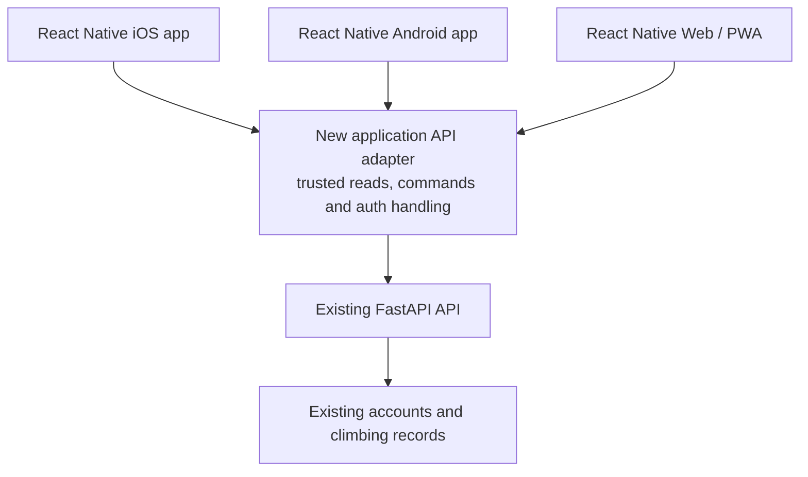

# Bouldy — React Native migration specification

> **Historical baseline — current-state notice, 31 October 2026.** The app now exists and its approved v35 redesign is published. The original planning-only, exact-copy visual, five-tab and M0–M2-only instructions below are historical, not the current continuation task. Use [DESIGN.md](../DESIGN.md) and [the current handoff](redesign/HANDOFF.md); preserve unchanged journal/auth/privacy invariants and keep unverified acceptance gates open. Original baseline text is retained below for provenance.

**Version:** 1.0 · **Prepared:** 28 October 2026  
**Status:** planning and source audit only. No target repository, Expo project, native build or migration implementation has been created.  
**Priority:** P1 — Highest. The native migration supersedes the earlier PWA-first delivery recommendation.  
**Product requirement:** move the current application into a separate React Native repository, preserving its existing UI, content, flows, functionality and business logic one for one.

## 1. Contract and scope

Build Bouldy as a React Native application using Expo, with iOS and Android as the primary delivery targets. The same new application repository must also produce the replacement browser application through React Native Web, with an installable PWA build. A PWA is the browser delivery, not the native iOS/Android binary.

The working target name is **`bouldy-mobile`**, proposed as a sibling of the current repository. This name/path is a planning assumption, not an existing repository or a remote that has been reserved. The new repository is for the Bouldy application and its necessary application API adapter; this plan does not create a marketing site or a second product.

### Non-negotiable parity requirements

- Preserve every current production screen, URL meaning, field, label, illustration, hold, button, status, sheet, error, loading state and available action. The current source, rather than the feedback wishlist, defines migration scope.
- Preserve information order, navigation destinations, number of steps, five-tab structure, Sessions/Climbs switch, route logging semantics, validation and feedback placement.
- Preserve Barlow Condensed, Geist, the selected Bolt B mark, the current palette, spacing, sizes, borders, shapes, icon paths, hold artwork and motion. Do not substitute a native design system or default Expo template styling.
- Preserve the compact phone canvas, including the maximum 430px canvas on larger screens. No tablet redesign, desktop dashboard, new navigation rail or replacement bottom bar.
- Keep planned screens visibly planned. A placeholder migration is complete when its current appearance and links match, not when its future feature has been implemented.
- Keep the existing accounts, record IDs, backend and history. The client rewrite does not require importing users into a new database.
- Preserve source restrictions and uncertainty: incomplete/ambiguous data must not become zero activity, a false flash, a merged route history or fabricated metrics.
- Keep the old repository and deployment available until the new application passes parity, release and rollback gates. Archive and retire later; do not delete now.

### What “one for one” means at acceptance

App-controlled content must be visually indistinguishable at matched logical viewport sizes and equivalent data/state. Every source interaction must have the same visible result and navigation destination. There are **zero intentional app UI or flow changes** in this migration.

Native and browser rendering engines are different. This document does not claim that copying CSS produces identical pixels on all devices. Font metrics, SVG support, safe areas and gesture handling must be measured and corrected during implementation. Browser/OS chrome, permission prompts and keyboards are system surfaces; record them separately from the app comparison. Rasterisation differences may be identified by an image-diff tool, but the tool must not silently waive layout, copy, colour or interaction differences. Any material app difference is a defect or an explicit user-approved exception; the implementing agent cannot approve it for itself.

### Explicitly outside migration scope

Do not add onboarding, simplify the journey, remove Add gym, introduce admin roles, add session cancellation, change Flash/Send terminology, implement photos/video/feed/groups/leaderboards/profile editing, add goals, implement offline writes, push notifications, health/watch/NFC/QR integration, add themes or make other brainstorm improvements. Keep existing planned links and text. App Store compliance changes that require new UI must be proposed separately, not inserted into the parity build.

This request authorises the plan and handoff. It is not an instruction to scaffold now, create or push a remote, change the backend, deploy, submit to stores, commit, or remove the source repository.

## 2. Source of truth and evidence

| Evidence | Current observation | How to use it |
| --- | --- | --- |
| Source checkout | `/Users/Ambassador/Desktop/Ameerul/Work/bouldy/bouldy-web` | Treat the current working tree as the implementation reference. |
| Inspected HEAD | `5467a433ea6699c1206b6e9019430fccff693918` | An anchor, not a substitute for the working tree and untracked local artifacts. |
| Source inventory | `docs/migration/source-inventory.json` | SHA-256 records for 157 source/config/reference files, screen/action/component mappings and image hashes. |
| Page inventory | 27 `page.tsx` routes | 14 functional screens, 10 planned screens, one alias and two development previews. |
| Other UI scope | Two global states; 19 loading boundaries; 31 component modules; 20 story files | Migrate states and shared behaviour as well as page compositions. |
| Behaviour scope | 11 exported Server Actions; 19 API helpers; eight `lib/*.ts` modules | See the parity register and sections 5–7. |
| Existing tests | 10 cases across two test files | Retain their assertions and add transport/navigation parity coverage during implementation. |
| Visual reference | 44 PNG captures, 390 × 844, reduced motion, 24 October | Historical sample-data references. Recapture/freeze before implementation; not production verification. |
| Backend contract | Public OpenAPI fetched 28 October, title `Bouldy API`, version `1.0.0` | Saved in `docs/migration/openapi-2026-10-28.json`; no authenticated writes were made. |

OpenAPI SHA-256: `073cd4de93a157b3cfbfa98bfa6f4ecfc922ae66890698a7400da8f018a782b2`.

Read in order: `README.md`, `MASTER_SPEC.md`, `docs/FRONTEND_SPEC.md`, `docs/BACKEND_SPEC.md`, `DESIGN.md`, then this specification and `docs/migration/PARITY_REGISTER.md`. If prose conflicts with source behaviour, record the discrepancy and use the frozen rendered implementation for parity. Do not silently implement a preferred interpretation.

At audit start the source had a pre-existing edit to `AGENTS.md` and untracked Impeccable review, brainstorm, feedback, Notion and visual-walkthrough artifacts. Preserve them. The Impeccable design sidecar was reported stale relative to `DESIGN.md`; it is not authority for changing the UI. No tooling refresh or visual redesign is part of this request.

### Durable supporting files

- [Full parity register](migration/PARITY_REGISTER.md): every source screen, Server Action and shared component.
- [Source inventory](migration/source-inventory.json): machine-readable paths, hashes, status and counts.
- `docs/migration/screen-parity.csv`, `action-parity.csv`, `component-parity.csv`: portable work registers, initially all Not started / Not verified.
- `docs/visual-walkthrough/screenshots/`: original image files; image-to-screen mapping is in the inventory.
- `docs/visual-walkthrough/bouldy-visual-walkthrough.html`: existing portable reference guide. Its proposed-flow discussion is not approval to change migration scope.
- `docs/migration/reference-fixtures/sample-api.cjs.reference.txt`: preserved local-only walkthrough fixture source from the earlier captures. The text extension keeps it an inert planning reference. Copy to a local test script only when running an authorised fixture check. Not a production backend or an ownership/security emulator; not started during this planning task.
- [Agent handoff](migration/IMPLEMENTATION_HANDOFF.md): continuation instructions and live Notion destinations.

## 3. Target architecture

### Recommended application structure

Use an Expo-managed React Native app with TypeScript and Expo Router. Use custom app-styled controls, headers and bottom navigation to reproduce the source. React Native Web provides browser rendering. Reanimated/Gesture Handler are proposed for the existing animation/gesture contracts; pin compatible versions only after selecting the then-current supported Expo SDK. Do not copy an unreviewed “latest” template and accept its appearance as the new baseline.

The following paths are proposed ownership boundaries, not generated files:

```text
bouldy-mobile/
  src/app/                    # Expo routes; same public path meanings and route params
    (auth)/                   # welcome, login, signup, development brand preview
    (app)/                    # protected screens and the identical custom app shell
    api/                      # deployed application API adapter (+api.ts handlers)
    +not-found.tsx
  src/components/             # parity equivalents of all current shared components
  src/features/               # screen compositions, view models, typed mutation controllers
  src/domain/                 # portable grades, journal summaries, route options and validators
  src/data/                   # typed client transport and account-scoped load/invalidation state
  src/platform/               # credentials, URL/history, focus, storage and browser/native adapters
  src/server/                 # trusted command handlers and FastAPI transport; never client bundled
  src/theme/                  # measured tokens, text roles, dimensions and motion constants
  assets/                     # unchanged artwork, fonts and native launch assets
  public/                     # web manifest/icons and restricted service-worker assets
  tests/                      # domain, command, integration, interaction and visual checks
  docs/                       # carried specs, parity register, decisions and release runbooks
```

Keep one product codebase. Platform-specific modules may differ internally where necessary, while their app appearance and visible flow remain the same. Expo’s server output/API routes require deployed server infrastructure; a native binary or static web folder cannot execute trusted server code by itself. [Expo API routes](https://docs.expo.dev/router/web/api-routes/).

### Preserve the trusted application layer

The current Next.js server does more than render pages. It holds the cookie, validates actions, re-reads current logs, checks route/session relationships and performs history checks before writes. Moving these checks exclusively into native JavaScript would weaken the current boundary.

**Recommended parity architecture:** move those responsibilities into a thin application API adapter owned by the new repository. Both native clients and web call it. The adapter runs the ported command handlers and calls the existing FastAPI service. It replaces the Next.js-specific action/cookie/redirect machinery without retaining a runtime dependency on the old repository.



This is an implementation recommendation to validate in the first technical slice, not evidence that the adapter is deployed. It adds an application-server deployment to the new repo; include its ownership, hosting and failure handling in the setup estimate. Its job is compatibility, not a second database or a new business API.

Direct native-to-FastAPI writes are an alternative only after backend source/tests prove that the equivalent trusted checks exist there. Removing the adapter can be a later change; it is not a shortcut around the migration’s guards. FE safeguards still do not replace backend ownership checks, database uniqueness or atomicity.

### Replace framework dependencies deliberately

| Current mechanism | Target mechanism | Parity requirement |
| --- | --- | --- |
| Next Server Components and page loaders | Screen controllers with typed loading/data/error states and adapter reads | Same summaries, empty/error distinctions and destination skeletons. |
| Server Actions / FormData / redirects | Typed client command + trusted server command + explicit navigation outcome | Same inputs, messages, checks and destination; no extra success screen. |
| `next/headers` cookies | Native SecureStore credential adapter; server-managed web cookie | Same login/signup/logout screens and failure states. |
| `proxy.ts` and app layout auth check | Root auth hydration + protected routes + server authentication | No private-content flash; signed-out destination remains Welcome. |
| `next/link`, `useRouter`, browser history | Expo Router plus a parity navigation/URL adapter | Same paths, explicit parents, replace/push decisions and sheet dismissal. |
| `next/image` and inline SVG | Bundled assets with tested SVG/image support | Exact hold/mark/icon geometry; retain grey fallback and blue variation. |
| Tailwind/CSS/OKLCH | Measured typed tokens and React Native styles; limited web adapter as needed | Do not approximate colours, spacing or typography by eye. |
| `motion/react`, WAAPI, CSS keyframes | Parity animation implementation with reduced-motion support | Match timings, distances, easing and trigger conditions. |
| `<dialog>`, `<details>`, sticky CSS | Controlled sheet, disclosure and scrolling primitives | Same placement, expansion defaults, dismissal and stacking. |
| React request `cache` | Request-scoped server memoisation and account-scoped client state | No cross-account data; preserve bounded fan-out and partial reads. |
| DOM events / `sessionStorage` | Typed UI events and platform filter-state adapter | Same one-shot notices and per-screen, per-login filter restoration. |

Do not use a WebView of the old site as the React Native migration. Do not ship default native tabs, system-styled cards, renamed buttons, new bottom-sheet detents or default stack animations simply because a package supplies them.

## 4. Complete screen migration map

The full row-by-row map, proposed target paths, source file paths and per-screen screenshot references are in [the parity register](migration/PARITY_REGISTER.md). All 27 current page routes have an explicit disposition. Two global states are tracked separately. Nothing in this table is implemented by this plan.

| Area | Current paths | Required migration |
| --- | --- | --- |
| Authentication | `/welcome`, `/login`, `/signup` | Same dark welcome composition, heading/hold art, fields, link wording, registration-to-login sequence, pending/errors and navigation. |
| Home | `/` | Same last-session board, Start link, real all-time metrics, recent three sessions and partial/empty states. |
| Gyms | `/gyms`, `/gyms/[id]` | Same list and Start buttons, Add gym sheet, active route browser, add/edit links and planned leaderboard link. |
| Route forms | `/gyms/[id]/routes/new`, `/gyms/[id]/routes/[routeId]/edit`, `/sessions/[id]/routes/new` | Same full-screen compositions, field order, live preview, colour grid, style expansion, beta link where present, sticky action and parent return. |
| Session journal | `/sessions` | Same featured board, outcomes, live/completed actions, month groups and three-month reveal. |
| Session detail | `/sessions/[id]` | Same live/completed layout, Today pins, progress filters, route-action sheet, correction disclosure, note editor, end-session sheet and route-history links. |
| Climbs | `/climbs` | Same Sessions/Climbs switch, gym drill-in, grade groups, search/filter counts, best result, tries and visits. |
| Route history | `/routes/[id]` | Same per-visit history, private notes, retired/partial/duplicate states and `from`-aware back link. |
| Owner profile | `/profile` | Same read-only identity and grade, summaries, visited gyms, planned settings links, journal link and logout. |
| Planned Explore | `/explore` and `/feed`, `/climbers`, `/leaderboards`, `/challenges`, `/groups` beneath it | Reproduce the current hub and UnderConstruction screens, copy, holds and related links. |
| Planned profile | `/profile/edit`, `/profile/public`, `/profile/privacy` | Reproduce planned pages; no editable identity, visibility settings or public data is added. |
| Planned route media | `/routes/[id]/beta` | Same valid route header and planned media screen. |
| Legacy alias | `/history` | Redirect/replace to `/sessions`, retaining its meaning for existing links. |
| Development previews | `/brand-preview`, `/loading-preview` | Keep reference/capture functionality development-only; production remains unavailable. |
| Global states | Branded 404 and authenticated error boundary | Same artwork/copy/actions, pending Reload behaviour and authentication-aware return. |

Do not create production screens from every API operation. DELETE endpoints, session-wide notes, public discovery and other API/backlog concepts without current working UI do not become new app controls.

### Interaction states that need their own coverage

1. Add gym sheet: field validation, pending, same-sheet failure and one-shot success.
2. Route filters: search, clear search, grade rail, Progress, Hold colour, Wall, optional Gym, counts, Clear all, Show results and empty-match state.
3. Grade disclosure and the collapse threshold above 12 unpinned routes; forced expanded/search states; Today pins.
4. Gym drill-in and All gyms return in Climbs; gym-local grade interpretation stays unchanged.
5. Route-action sheet: earlier versus current counts, first-try Flash versus Sent, +1, legacy Zone, completed/retired/conflicting/unknown-history cases.
6. Correction disclosure: result/count, exact eligibility choices, pending, inline error and closed-on-success state.
7. Private note editor: inline when already in a route sheet; its own sheet in history; cancel, empty-note save, retained draft on failed save and independent success.
8. End session: existing default duration 60, pending and error. Keep the source’s positive-duration/finished-session convention; do not introduce a timer.
9. Full-screen route forms: empty/edit-populated preview, 14 colours, main and additional styles, keyboard-visible lower fields and sticky save.
10. Navigation/load feedback: destination skeletons, branded loader variants, eight-second patience text, inline warnings, retry and top snackbar.
11. Auth and app re-entry: valid/invalid credentials, duplicate registration responses, expired session, logout/account switch, background/resume and valid/invalid resource IDs.

## 5. Behaviour and domain rules to preserve

### Portable logic

Move the logic from `lib/journal-summary.ts`, `lib/route-grades.ts` and `lib/route-options.ts` with their existing assertions. Type imports can move; outputs cannot change. Keep free-text gym grades and numeric-aware sorting, case/space grade keys and the all-search-terms matching rule. Do not add grade conversion or normalise gym grading systems into one scale.

`lib/utils.ts` is a Tailwind class-composition helper, not a domain algorithm. Replace it with the new styling composition mechanism while preserving every caller’s visual result. Preserve `lib/api.ts` types and helper semantics, including the gym-scoped routes fallback; move transport into the server adapter. Replace `lib/session.ts`, `lib/actions.ts` and the React-specific caching wrapper rather than importing Next dependencies into a native bundle.

### Page-level logic is also migration scope

The next agent must extract and compare logic embedded in page/components, not just the eight library files:

- Home: date formatting, latest record, recent-three slice, summary reliability and missing-gym fallback.
- Sessions: latest board, active unlogged-route count, result strip, month grouping, complete-data totals and three-month reveal.
- Session detail: visible active/historic route union, ended-session logged-only view, per-route states, previous-visit exclusion, Today pins and status text.
- Climbs: unique logged route IDs, best-result order **Flash → Send → Zone → Project**, visit count, gym grouping and missing-route warning.
- Route history: session-level entries, ambiguous-total suppression and owner-validated `from` parent selection.
- Profile: owner-only fields, reliable stats and unique visited gyms.
- RouteBrowser: option generation, dependent counts, grade/name ordering, search mode, >12 collapse threshold and filter restoration.

Preserve existing date behaviour. Action creation currently uses `new Date().toISOString().slice(0, 10)`; displayed date-only values use `en-MY` with a local-noon anchor. A timezone correction or session ordering redesign is separate work. Same-date sessions have no authoritative time order; do not invent one.

### Journal and counting invariants

- One attempt record is an aggregate for a route within a session, not one record per physical try.
- A first `+1` creates one project try; later `+1` increments only the current session record.
- Sending an existing project updates its result without adding a try. A send with no current record creates one successful try.
- Flash is offered only when complete, unambiguous lifetime history confirms no earlier try, and its count is exactly one. Previous attempts from another session never become today’s count.
- Completed Send/Flash records cannot be incremented through logging; correction is a distinct action. Completed-session correction remains unavailable.
- Existing Zone records remain readable/correctable. A new Zone action remains gated by `is_competition`; the published contract currently lacks that field. Do not make it live locally.
- Duplicate session-route logs remain visible in source history while affected totals are unavailable; mutation/correction pause where the source pauses them.
- Failed history reads remain distinguishable from an empty successful read. Unknown totals stay unavailable, not zero.
- Retired route history survives; resets with new route IDs remain separate even when names, colours or grades match.
- Private notes PATCH only `notes`. Saving/cancelling/failing a note never changes count or result.
- `duration_minutes === 0` means live in the current UI; positive means completed. Preserve this convention until a separate backend lifecycle change is approved.

### Journal loading and invalidation

Retain newest-date-first ordering and at most six concurrent session-attempt loads. Preserve request memoisation semantics and distinguish a failed session list from one failed visit. Authentication failures propagate; they must not become an ordinary empty journal.

Scope all client state to the authenticated account. On login/logout or account change, clear old owned data, note drafts and filter stores. Mutation success refreshes affected session, route history, Climbs, Home and profile summaries with the same visible result as current invalidation. Do not cache private responses in a service worker. Do not enable automatic write retries or an offline mutation queue; the current count updates are not proven idempotent/atomic.

## 6. Action, API and authentication migration

### Command contract

The [action parity table](migration/PARITY_REGISTER.md#server-action-parity) covers all **11** current exports: login, signup, logout, start session, add gym, add route, edit route, log attempt, correct attempt, end session and save note.

For each command, port the current server validation/read-before-write steps into the trusted adapter and return a typed outcome containing data or field/page/sheet error plus the required navigation/notice effect. UI controllers must reproduce the source effect; HTTP response mechanics need not reproduce Next’s internal action protocol.

Keep the existing checks at their current strength. Audit backend source/tests before claiming backend ownership, uniqueness, lifetime Flash or concurrency guarantees. If parity depends on a missing backend guarantee, record the dependency and resolve it; do not claim the native client enforces ownership. Conversely, do not create new destructive repair, merging or deduplication behaviour during migration.

### Existing FastAPI operations the current client actually uses

| Domain | Existing consumed operations | Important behaviour |
| --- | --- | --- |
| Auth | `POST /auth/register`, `POST /auth/login`, `GET /auth/me` | Login sends email in form field `username`, with the existing password grant payload. No OAuth/phone signup is added. |
| Gyms | `GET /gyms/`, `GET /gyms/{gym_id}`, `GET /gyms/{gym_id}/routes`, `POST /gyms/` | Retain `getGymRoutes` fallback to all routes/filter for the source’s 404/5xx cases. |
| Routes | `GET /routes/`, `GET /routes/{route_id}`, `POST /routes/`, `PUT /routes/{route_id}` | Preserve IDs, payload fields, styles and active/retired meanings. |
| Sessions | `GET /sessions/`, `GET /sessions/{session_id}`, `POST /sessions/`, `PUT /sessions/{session_id}` | Keep current duration semantics and create payload compatibility; current authenticated identity supplies `user_id`. |
| Attempts | `GET/POST /sessions/{session_id}/attempts`, `GET/PATCH /attempts/{attempt_id}` | Preserve aggregate counts/results, notes-only PATCH and typed API error messages. |

There are 19 exported helpers implementing this consumption. Preserve all in the inventory, including helpers used indirectly by guards. The OpenAPI listing alone does not verify runtime permissions or successful writes. The FastAPI source is outside this repository and was not re-audited for this planning task.

### Session adapters

**Native:** use the existing backend login and JWT, with credentials stored using an appropriate SecureStore adapter. Rehydrate before showing protected data, validate with `/auth/me`, and clear session-owned state on logout or expired/invalid auth. A resource-specific 403 is not automatically an expired login; preserve that screen's current denied/not-found/error outcome. Do not store passwords, put bearer tokens in route parameters or use an unprotected persistent token store. The API publishes no refresh endpoint; do not invent a refresh-token flow. [Expo SecureStore](https://docs.expo.dev/versions/latest/sdk/securestore/).

**Web/PWA:** retain an HTTP-only, production-Secure, SameSite-compatible cookie through the new same-origin application adapter. Preserve the current cookie meaning and lifetime ceiling; backend token expiry remains authoritative. Browser requests use credentialed same-origin commands. Native bearer and web-cookie authentication share command logic but not credential storage.

The new adapter must explicitly replace protections previously supplied by Next Server Actions: authenticate protected calls, validate method/body/IDs, protect cookie-based writes against CSRF/cross-origin misuse, avoid an open arbitrary-URL proxy, and keep upstream tokens and server-only code out of browser bundles/logs. These are replacement responsibilities, not new app screens. Secrets must not use client-public environment variables.

A native installation cannot inherit the old browser cookie. Existing users use the same credentials and account records; initial sign-in in a new client is expected. Reusing an existing browser cookie at the eventual same-origin web cutover is conditional on compatible domain/cookie handling and `/auth/me` validation; do not promise seamless transfer to a different origin.

### Backend responsibilities and dependencies

The baseline client port can retain FastAPI and its data model. BE involvement is needed to verify security/integrity behaviour, support any incompatible contract discovered in the trial, and later satisfy release requirements such as account deletion. No database, ID or password migration is proposed.

Do not mix the migration with the unimplemented FE/BE feature backlog. A pre-existing backend failure should be reproduced and recorded separately from a migration regression. Resolve release-blocking issues before cutover, with additive contracts where needed. Never weaken validation or hide an error to make screenshots appear to pass.

## 7. Visual, motion and navigation parity

### Design extraction

Use rendered source and `app/globals.css`/component classes to create typed measurements. `DESIGN.md` explains intent but cannot override actual per-screen values. Preserve inline semantic colours as well as named variables. Convert OKLCH to supported native colour values using a verified conversion/render comparison; do not choose approximate hex colours.

Bundle the licensed source-equivalent Barlow Condensed weights 600/700/800 and the used Geist/Geist Mono weights. Pin font files/versions and hashes, measure line breaks/baselines, and test Android font padding and iOS metrics. Wait for fonts in visual tests. Do not use a system condensed substitute. [Expo fonts](https://docs.expo.dev/develop/user-interface/fonts/), [React Native text style properties](https://reactnative.dev/docs/text-style-props).

There are 24 `public/` assets, including 14 colour holds, the extra blue-triangle hold and the selected Bolt B plus unused/proposal/starter art. Preserve and classify all assets in the new repo. Do not render unused assets as new features. Keep the additional `app/icon.svg` and favicon reference as well. The RouteHold rule selects the blue triangle for blue routes whose names match `arete`, `triangle` or `volume`; unknown colours fall back to grey. Test SVG gradients/filters against the reference and use a faithful derivative asset only when rendering support requires it. [Expo SVG support](https://docs.expo.dev/versions/latest/sdk/svg/).

### Controls and shared components

All 31 current component modules have an explicit disposition in the parity register, including unused/development-only modules. Twenty story files supply component states. Port representative stories to the new component catalogue or an equivalent isolated development screen; do not copy Next-specific story wrappers into the native runtime.

Use custom controls for app chrome. Native default tabs, headers, buttons and sheets are not acceptable visual replacements. Keep existing select choices and field behaviour; compare closed controls and the applicable OS selection surface without inserting a new app step. Retain focus, labels, error announcements, accessibility roles and reduced motion. Match captures at standard text scale and test readable enlarged text without disabling accessibility to hide differences.

The current ThemeSwitcher is an unmounted development comparison tool. Blue/green token definitions are not authorisation to add theme selection. RouteMark is currently dormant. Preserve their reference value without making them newly reachable product features.

### Navigation state

- Keep Home, Explore, Sessions, Gyms and You in the same order with the same icons and labels. `/climbs` remains selected under Sessions.
- Keep full-screen route forms without bottom navigation and with their current sticky action.
- Keep explicit parent destinations rather than making every back chevron an unrestricted history pop. Route history’s `from=climbs` or verified owned session context retains its meaning.
- Retain web paths and query meanings: `sheet`, `from`, `error`, `notice`, `route`, filter keys and `#route-<id>`. Native deep links map to the same screen/state. This is migration of existing link meanings, not a new deferred-link/login flow.
- An opened sheet consumes a Back step before leaving its page. Dismissal via close, backdrop, swipe or Back has the same result. Save/error navigation uses replacement where the source does so Back cannot reopen a finished sheet. Test cold deep links as well as links opened inside the app.
- Opening a route sheet must not be blocked by a collapsed grade group. Keep overlays outside clipped/translated list content and preserve focus restoration on web.
- Search/filter changes do not add server round trips or browser history entries. Remember filters per screen context, restoring them when a command drops query state. On native, use equivalent transient session-scoped state; do not introduce durable cross-account saved preferences.
- Preserve source scroll-to-top on route changes and route-anchor behaviour after logging. Do not add a new scroll-retention feature.

### Motion and feedback constants from source

| Behaviour | Current contract |
| --- | --- |
| Main tab page entry | 220ms, 18px directional X movement, opacity 0.7 to 1; cubic-bezier(0.22, 1, 0.36, 1). |
| Deeper/back page entry | 260ms, 28px directional X movement, same fade/easing; derive direction from source navigation. |
| Main tab swipe | Only current top-level paths; ≥90px horizontal travel and horizontal ≥2× vertical; exclude controls and 28px screen edges. |
| Bottom sheet | 260ms entry, 200ms exit, same backdrop/panel geometry; handle drag closes above 80px. |
| Snackbar | Top overlay outside PageMotion; 5 seconds visible; 260ms entry from -16px, 180ms exit; tap anywhere dismisses; consume notice once. |
| Loading | Nine skeleton geometry variants, branded ascent/traverse/hold motifs; patience text after 8 seconds; source navigation safety timeout is 45 seconds. |
| Reduced motion | Remove movement/looping where source does; preserve visible states and messages. |
| Button/link feedback | Keep current local spinner, label space, pending copy and web hover/focus animation; no new haptics. |

Disable navigator animations where they would stack an extra transition over the reproduced PageMotion. Do not replace source motions with a spring because it feels more native. App transitions are compared from recordings as well as still images. [Expo custom tabs](https://docs.expo.dev/router/advanced/custom-tabs/), [Reanimated support](https://docs.expo.dev/versions/latest/sdk/reanimated/).

## 8. Web/PWA replacement and data continuity

The replacement browser app must originate from the new Expo repo. Keeping the old Next app as the permanent web frontend would not meet the requested retirement goal. The same app screens can share React Native components through React Native Web, with platform adapters for browser semantics. [Expo web support](https://docs.expo.dev/workflow/web/).

Deliver web parity alongside native parity before the old web deployment is retired. Then add PWA installation metadata, icon variants, correct launch/scope settings, browser-specific installation instructions and a small service worker. Installation controls belong to the installation surface; do not rearrange existing app screens to add promotional banners without approval. [Expo PWA guide](https://docs.expo.dev/guides/progressive-web-apps/).

Use explicit public/static asset allowlists. Keep authenticated HTML/data, API responses, commands, cookies and private notes out of service-worker caches. First delivery stays online for reading/writing climbing records, with an honest generic offline fallback. Do not queue +1, Send or note writes. A native bundle being locally installed is not proof that its journal works offline.

For updates, prevent forced reload during unsaved input, version caches and document rollback/worker removal. Test browser and installed modes separately, including restart, update, lost network, expired session, logout and account switch. A static client build still needs the separately deployed application adapter for cookies and trusted commands.

Keep existing account/session/route/attempt IDs and private-note ownership. No content export/import or duplication is part of migration. Verify old browser and new clients reading the same test records through the same backend, then authorised staging/test-account writes. Cutover must not double-create an account/session or replay an attempt because a new client was installed.

Before web cutover, test every existing route/alias and query meaning under the intended domain. Record which cookies can be reused and which users must sign in again. Preserve deep links and the old deployment as a rollback target during the agreed observation period.

## 9. Delivery work packages and gates

All effort ranges below are provisional engineering days, not calendar commitments. They assume one experienced React Native engineer with part-time BE/QA support, source access and available iPhone/Android devices. Sum: **26–44 engineering days**, before backend fixes, store compliance work and external review. Re-estimate after M2; a small codebase still has substantial parity/test work. No owner or date is assigned.

| ID | Deliverable / responsibility | Difficulty; provisional effort | Depends on | Exit evidence |
| --- | --- | --- | --- | --- |
| M0 | Freeze source and parity evidence — FE/QA | Medium; 2–3 days | Implementation authorised | Working-tree snapshot, carried docs/fixtures/art, fresh matching-state captures and complete state register. |
| M1 | Create separate Expo repo and build foundations — FE/Platform | Medium; 1–2 days | M0 | New sibling repo, supported SDK/dependency lock, iOS/Android dev builds and web+adapter build; original app untouched. |
| M2 | Prove auth + exact shell + one route/log slice — FE/BE/QA | High; 3–5 days | M1 | Custom source-matching shell, persisted auth, one trusted command and error, same +1/Send behaviour; device/web visual and data evidence. |
| M3 | Port domain, API adapter and all 11 commands — FE/BE | High; 3–5 days | M2 | All current guard/message/navigation outcomes mapped; existing 10 domain tests plus command equivalence tests pass; cross-account isolation checked. |
| M4 | Port shared UI, motion and all 24 app screens — FE | High; 7–12 days | M2 and relevant M3 handlers | Every screen/component row implemented, all planned screens unchanged, interactions/loaders/notes/forms covered on three targets. |
| M5 | Finish web/PWA compatibility and lifecycle — FE/Platform | Medium–High; 2–4 days | M4 | Existing URLs/queries/redirects, cookie boundary, browser and installed-mode parity, installation/update/offline fallback tests. |
| M6 | Complete parity and device regression — FE/QA/BE | High; 5–8 days | M3–M5 | Source/new image comparisons, motion clips, full flow assertions, state/ownership checks and zero unapproved product deviations. |
| M7 | Controlled replacement and retirement preparation — Platform/QA/Product | Medium; 3–5 days | M6 plus release prerequisites | Internal distribution, authorised web cutover, monitored real-device checks, rehearsed rollback, archive-ready source backup. |

### M0 — Freeze the reference before building

1. Re-read source instructions and compare the 157 file hashes with the current tree. Explain drift before replacing the reference. Preserve all local/untracked artifacts; never reset the checkout to HEAD to create a “clean” baseline.
2. Create a recoverable source snapshot and carry this spec, inventories, visual references, documentation, fixture and licences into the future repo. No commit/push is authorised now; agree the snapshot mechanism when implementation starts.
3. Recapture the current UI with deterministic sample data, seeded IDs and a frozen clock. The archived local fixture provides the earlier walkthrough data; extend test fixtures for missing states instead of mutating production records.
4. Compare the existing 44 references with current rendered source, document freshness, then freeze new goldens at 390 × 844 and supported alternate widths. Keep samples and banners visibly in the same test mode; they never ship in production.
5. Fill state coverage and record tap paths/expected data changes, loading, Back and feedback. Capture normal motion separately because the existing PNGs used reduced motion.

**M0 is not complete in this planning task:** source inventory/reference preservation is done; fresh golden capture and complete scenario harness still need implementation-time work.

### M1–M2 — Validate the costly assumptions early

Use proposed sibling path `/Users/Ambassador/Desktop/Ameerul/Work/bouldy/bouldy-mobile`; verify no unrelated repo already occupies it. When implementation is requested, use a `codex/` branch and initialise the new repo without altering old Git history. Remote hosting, account IDs, bundle IDs and signing belong to the setup decision; do not invent an owned domain or create external accounts silently.

Confirm a supported Expo/RN/Router/animation combination, native toolchain, font/SVG compatibility and web server adapter deployment. Run dependency review and Expo compatibility checks before pinning libraries. Physical devices must be able to reach a dedicated development/test API; phone loopback is not the Mac’s loopback. Any test endpoint override stays build-time/dev-only, with honest preview labelling and production exclusion.

The M2 trial is a parity slice, not a redesigned prototype: Welcome/Login → unchanged Home/shell → fixture session → same route sheet → +1/Send → same saved history. Include one failed-save state, back dismissal, process restart and web-cookie/native-credential handling. Block further rollout if fonts/art/layout, trusted commands or navigation cannot meet the contract. Re-estimate the remaining work using trial evidence.

### M3–M5 — Migration sequence

Recommended order inside M4: primitives/fonts/assets/shell → auth → gyms and route forms → session detail and all sheets → session journal/Climbs/history → owner profile → unchanged planned pages → global errors/loading/development catalogue. A new screen is not complete until data/controller, loading/error/empty states, navigation and visuals are all checked.

Keep the action and component registers current as work is completed; record tests and comparison images per row. Do not mark an entire phase done from screenshots alone. Carry original code/docs provenance into the new repo so retiring this checkout does not erase the only explanation of an algorithm or constraint.

## 10. Verification and acceptance

### Visual comparisons

- Compare frozen source and new app with the same fixtures, dates, locale, logical dimensions, font loading and scroll/state. Use 390 × 844 as the primary historical reference and 320, 430 and 1440px web captures for existing responsive constraints. Also test the actual logical dimensions of shipped iPhone and Android devices.
- Compare full content and scrolled states, not only the first screenful. Include open filters, route sheet, correction disclosure, note editor, form bottom/save bar, keyboard-visible states, empty/error/partial states and every planned screen.
- Normalize external OS/browser chrome and documented system insets. Do not crop away app defects, remove labels or change fixture content to reduce a diff.
- Require zero copy, asset, field-order, navigation or state-semantic differences. Establish image-diff settings on the same-source renderer first; record antialias noise separately. No arbitrary global percentage may hide a moved control or wrong font.
- Review tab/push/sheet/snackbar/loading recordings against the source timing contract, including interruption, repeated taps and reduced motion.

### Behavioural acceptance set

1. All 27 route dispositions and two global states are accounted for; all 24 application screens pass in iOS, Android and web. Development previews remain production-inaccessible.
2. Auth forms, errors, account re-entry and logout match; no cross-account data/cache leakage or protected-content flash.
3. Start a session from both current gym entry points; create/edit a route from all three forms; adding a route does not also log it.
4. First try, repeated try, existing-project Send and true first-lifetime Flash produce the same payloads/counts/results as the source. Four old plus two new tries remain separate and total six.
5. Correction can reduce counts/change result under the same existing eligibility rules without adding a try. Completed, wrong-gym, retired, stale and duplicate cases retain their restrictions.
6. Private note add/edit/empty/cancel/failure works from live/completed session context and route history, with draft retention and no count/result change.
7. Search, multi-term matching, all filters, dependent counts, clearing, grade ordering, >12 collapsing, Today pins and restored filters match. Climbs drill-in does not compare unrelated gym grade scales.
8. Home, featured session, month totals, Climbs best result and owner profile agree with identical records. Empty, unavailable, partial and ambiguous data remain distinct.
9. End session uses the same duration rules, closes to the journal, and switches the detail UI to the same completed state.
10. Back, close, backdrop, handle swipe, tab swipe, explicit parents, cold deep links, route anchors and save/error replacements match. No completed sheet reopens from stale history.
11. Branded loading, pending labels, warning/retry placement and one-shot top success snackbar match. Failure never presents as success.
12. PWA install/launch, refresh, update and connection-loss behaviour work without private caching or queued writes; native suspend/restart and token expiry behave correctly.

### Engineering checks

Carry the two existing test files and their 10 assertions into the new test environment. Add meaningful command equivalence, navigation, adapter/authentication, fixture integration and visual tests during implementation. Validate on physical iPhone and Android hardware in addition to simulators/browser. Component stories/catalogue and route coverage are acceptance tools, not substitutes for end-to-end checks.

Run the new repo’s lint, TypeScript, domain/command tests, Expo dependency/doctor checks, web+server build and iOS/Android development/release build checks appropriate to the phase. Existing source checks establish reference health only; they do not prove a migration that has not been built. Record local fixture evidence separately from authorised live API smoke tests.

## 11. Release, rollback and old-repository retirement

### Distinguish parity from store readiness

A parity build is the requested copy. A store release additionally needs developer accounts/signing, icons/listings/screenshots, support/privacy details, reviewer access and current platform requirements. Account deletion is not published in the inspected Bouldy API and is absent from current UI. Since adding it would change UI/functionality, treat it as a separately reviewed release requirement, not an unnoticed migration edit. Store review cannot be promised by choosing React Native. [Apple review guidelines](https://developer.apple.com/app-store/review/guidelines/), [Google Play deletion requirements](https://support.google.com/googleplay/android-developer/answer/13327111?hl=en).

### Cutover gates

- All screen/action/component parity rows have evidence; no unresolved critical functionality, data-isolation, navigation or material visual defects.
- New app and its server adapter have independent build/deploy instructions, environment configuration, logs and a responsible team owner. No runtime import, asset or network dependency on the old Next deployment remains.
- Authorised test-account data persists correctly through old/new-client reads, restart, account switching and web-domain cutover. No data/schema migration is performed merely to change clients.
- Browser URL/deep-link compatibility and PWA cache upgrade/removal paths are verified; native internal testing is complete. Store publication remains a separate authorised action.
- A previous new-app/adapter release and the old web deployment are recoverable. Rehearse rollback; do not rely on “we can rebuild it later.”
- Agree an observation period and practical checks after cutover; no duration is invented by this plan. Native store rollback is not an instant web redeploy: preserve backend compatibility with installed older builds and plan a corrective release if needed.

### Retirement sequence

1. Copy all required specs, artwork/font licences, test fixtures, screenshots, tests, operational notes and relevant Git provenance into the new repo or a recoverable archive.
2. Verify the archive, including uncommitted/untracked work and required ignored files. Exclude credentials and build caches; preserve required configuration through secure environment management.
3. After parity approval, authorised replacement, observation and rollback checks, mark the old repo/deployment deprecated and archive it.
4. Physical deletion, removal of the remote or loss of the old deployment is a later explicit operation. “We can drop it once done” does not authorise destroying the current source during planning.

## 12. Decisions and remaining uncertainties

| Item | Current direction | Evidence still needed |
| --- | --- | --- |
| Primary platform | User-selected native/mobile-first; Expo iOS/Android plus replacement web/PWA in one repo | Exact supported device/OS/browser matrix at M0. |
| Visual/flow scope | Fixed source copy; no product redesign | Frozen current renders, motion clips and review of any unavoidable system-surface differences. |
| Repo/path | Proposed sibling `bouldy-mobile` | Verify availability and remote owner when implementation is authorised. |
| Server strategy | New thin adapter preserving current trusted action checks | M2 deployment/auth trial; BE audit before removing any guard. |
| Expo/package versions | Select supported compatible versions at setup | Toolchain/device build and font/SVG tests; avoid relying on a changing SDK-transition default. |
| Web domain/session continuity | Preserve current URL meanings and same-origin cookie model | Hosting/cookie migration rehearsal and domain decision. |
| Backend integrity | Preserve client/adapter checks; no guarantee inferred from schema | Current backend source/tests for ownership, duplicate/retry, concurrency and lifetime eligibility. |
| Store compliance | Separate from parity; account deletion likely adds FE+BE scope | Team-approved release exception/design and actual implementation before submission. |
| Total delivery | 26–44 provisional engineering days for parity migration | Re-estimate after M2; backend fixes, compliance and review excluded. |
| Old-repo retirement | After all gates; recoverable archive first | Verified cutover/rollback/observation and a later explicit retirement instruction. |

None of these open items prevents preparing this plan. Items affecting implementation must be resolved at their gate, not filled with invented API contracts or silent UI changes.

## 13. Planning completion and agent continuation

Completed in this planning task: current-source audit; 27-route coverage plus global states; action/API/component inventory; preserved screenshot and source hashes; public API snapshot; proposed architecture; work packages; parity/release/retirement gates; local spec and Notion handoff publication.

Not completed: new repo creation; native/web migration; new goldens; new UI or backend behaviour; device builds/tests; store account setup/submission; production writes; deployments; commits/pushes; archival/deletion. Every migration row remains Not started / Not verified.

Use [the agent handoff](migration/IMPLEMENTATION_HANDOFF.md) as the next entry point. When implementation is explicitly requested, begin with M0 and M1, prove M2 before expanding, and keep the old repo intact. The new UI is a reproduction of the current app; skills and template defaults must yield to this specification’s one-for-one constraint.
